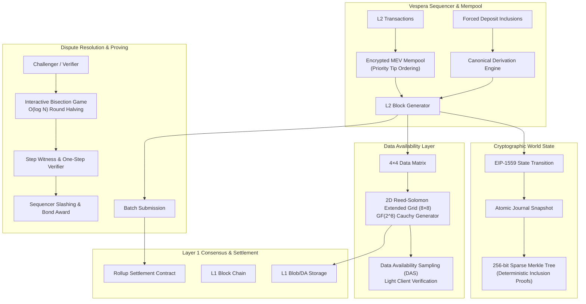
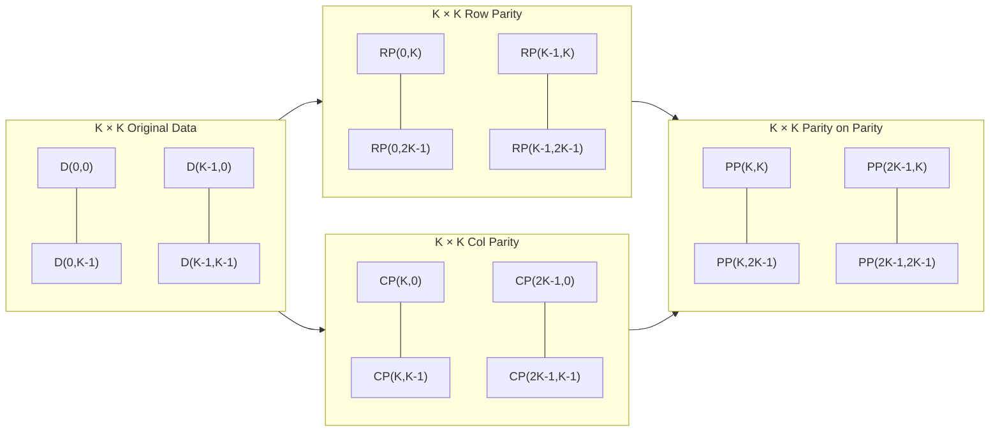
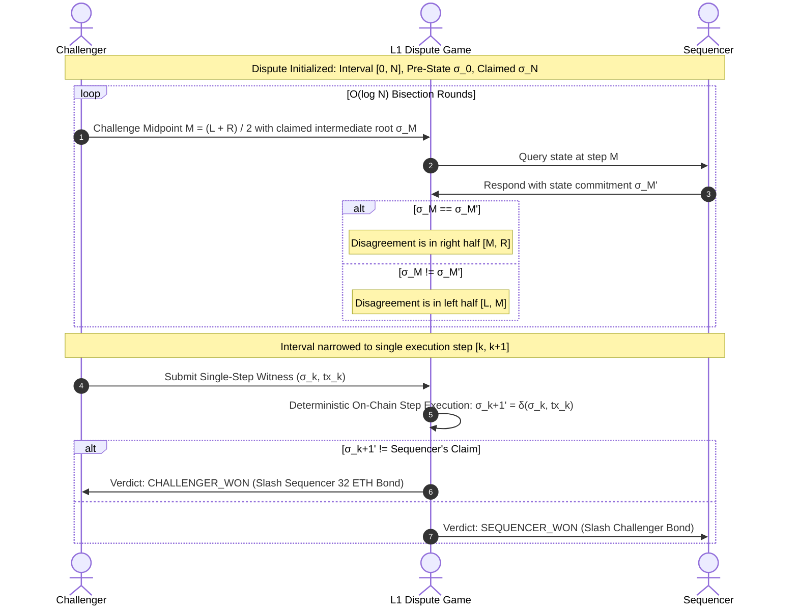

# VesperaRollup

[](https://github.com/ZengLLQ/vespera-rollup/actions/workflows/ci.yml)
[](https://goreportcard.com/report/github.com/ZengLLQ/vespera-rollup)
[](https://opensource.org/licenses/MIT)
[](https://golang.org/)

**VesperaRollup** is a high-performance, decentralized Based Rollup and Shared Sequencer engine written in idiomatic Go with **zero external dependencies**. It integrates an authenticated Sparse Merkle Tree (SMT) world state, an EIP-1559 priority fee transition runtime, 2D Reed-Solomon Data Availability Sampling (DAS), and an interactive logarithmic bisection dispute game with single-step fraud proof verification.

---

## Architecture Overview



---

## Core Mathematical Foundations

### 1. Reed-Solomon Erasure Coding over $\text{GF}(2^8)$

The Data Availability engine constructs an extended 2D matrix using a systematic Cauchy generator matrix over the Galois field $\text{GF}(2^8)$, defined by the Rijndael primitive polynomial:

$$p(x) = x^8 + x^4 + x^3 + x^2 + 1 \quad (0\text{x}11\text{B})$$

Given $K$ original data shards $D = [d_0, d_1, \dots, d_{K-1}]$, the engine encodes $M = K$ redundant parity shards $P = [p_0, p_1, \dots, p_{M-1}]$ via a Cauchy matrix $G \in \text{GF}(2^8)^{(K+M) \times K}$ where:

$$G_{i,j} = \begin{cases} 
\delta_{i,j} & 0 \le i < K \\
\frac{1}{x_i \oplus y_j} & K \le i < K+M 
\end{cases}$$

with pairwise disjoint elements $x_i, y_j \in \text{GF}(2^8)$ ($x_i \oplus y_j \ne 0$).

#### 2D Data Availability Matrix

The 2D matrix expands an original $K \times K$ payload matrix into a $(2K) \times (2K)$ extended grid by encoding each row and column:



Light clients sample random cells $(r, c)$ in the $(2K) \times (2K)$ space. If any cell is withheld by an adversarial sequencer, an attacker must withhold $> 25\%$ of cells in the extended matrix to make the block unrecoverable. Sampling $s$ independent random cells provides guaranteed data availability confidence:

$$\mathbb{P}(\text{Available}) \ge 1 - \left( \frac{3}{4} \right)^s$$

For $s = 20$, light-client confidence exceeds $99.68\%$.

---

### 2. 256-bit Sparse Merkle Tree (SMT)

The state trie is implemented as a 256-level binary Sparse Merkle Tree indexing cryptographic keys $k \in \{0, 1\}^{256}$.

- **Empty Tree Optimization:** Default null roots at depth $d$ are precomputed recursively:
  $$\text{emptyRoot}[0] = \text{Hash}(0), \quad \text{emptyRoot}[d] = \text{SHA256}(0\text{x}01 \mathbin{\Vert} \text{emptyRoot}[d-1] \mathbin{\Vert} \text{emptyRoot}[d-1])$$
- **Leaf Commitment:**
  $$H_{\text{leaf}} = \text{SHA256}(0\text{x}00 \mathbin{\Vert} k \mathbin{\Vert} \text{AccountEncoding}(v))$$
- **Internal Node Commitment:**
  $$H_{\text{node}} = \text{SHA256}(0\text{x}01 \mathbin{\Vert} H_{\text{left}} \mathbin{\Vert} H_{\text{right}})$$

Inclusion proofs contain exactly $256$ sibling hashes corresponding to each bit of key $k$, enabling logarithmic $O(256)$ deterministic inclusion verification on constrained L1 environments.

---

### 3. EIP-1559 Dynamic Base Fee Mechanism

Vespera implements the canonical EIP-1559 fee market algorithm for layer-2 block congestion control:

$$\Delta_{\text{gas}} = \text{GasUsed}_k - \text{GasTarget}$$

$$\text{BaseFee}_{k+1} = \text{BaseFee}_k \cdot \left( 1 + \frac{\Delta_{\text{gas}}}{\text{GasTarget} \cdot 8} \right)$$

Transactions enforce:

$$\text{EffectiveTip} = \min(\text{GasTipCap}, \text{GasFeeCap} - \text{BaseFee})$$

$$\text{TotalFee} = \text{GasUsed} \cdot (\text{BaseFee} + \text{EffectiveTip})$$

Base fees are burned or remitted to L1 data posting vaults, while priority tips are rewarded to the active sequencer.

---

### 4. Interactive Bisection Dispute Game

When a challenger disputes an L2 rollup batch transition containing $N$ execution steps between agreed pre-state $\sigma_0$ and claimed post-state $\sigma_N$, the protocol engages in an interactive bisection dispute game.



The dispute game reduces an arbitrary block execution of $N = 10^7$ steps down to a single disputed instruction in $\lceil \log_2(10^7) \rceil = 24$ interactive rounds, preserving minimal on-chain L1 gas overhead.

---

## Project Structure

```
F:\VesperaRollup
├── cmd/
│   └── vespera/
│       └── main.go               # Multi-command interactive CLI entrypoint
├── pkg/
│   ├── crypto/
│   │   └── merkle.go             # 256-bit Sparse Merkle Tree & inclusion proofs
│   ├── da/
│   │   ├── erasure.go            # GF(2^8) Galois field arithmetic & Cauchy RS encoder
│   │   └── sampling.go           # 2D Extended Matrix & Data Availability Sampling
│   ├── dispute/
│   │   ├── bisection.go          # O(log N) Interactive Bisection Game protocol
│   │   └── witness.go            # Single-step execution witness & fraud verifier
│   ├── mempool/
│   │   └── mempool.go            # Priority tip mempool with commit-reveal MEV envelopes
│   ├── sequencer/
│   │   ├── derivation.go         # L1 forced-inclusion queue & canonical derivation
│   │   └── sequencer.go          # L2 block producer & L1 rollup batch aggregator
│   ├── state/
│   │   ├── state.go              # WorldState, SMT commitments & atomic journal snapshots
│   │   └── transition.go         # EIP-1559 base fee adjustments & state transitions
│   └── types/
│       └── types.go              # Core domain models (Transaction, Header, Block, Batch)
├── test/
│   ├── da_test.go                # Reed-Solomon reconstruction & 2D DAS tests
│   ├── derivation_test.go        # L1-to-L2 derivation & deposit queue tests
│   ├── dispute_test.go           # Interactive bisection & single-step proof tests
│   ├── mempool_test.go           # Nonce ordering, replacement rules & commit-reveal tests
│   └── state_test.go             # SMT proofs, atomic rollback & EIP-1559 tests
├── .github/
│   └── workflows/
│       └── ci.yml                # Multi-platform (Linux, macOS, Windows) matrix CI
├── go.mod                        # Go module configuration (Zero dependencies)
├── LICENSE                       # MIT License
└── README.md                     # Comprehensive documentation
```

---

## Installation & CLI Usage

### Prerequisites
- Go 1.22 or higher installed.
- No external packages or CGO dependencies required.

### Build
```bash
git clone https://github.com/ZengLLQ/vespera-rollup.git
cd vespera-rollup
go build -o bin/vespera ./cmd/vespera
```

### Running CLI Commands

#### 1. L2 Sequencer Simulation
Simulate account funding, mempool queueing, EIP-1559 block production, and L1 batch commitment:
```bash
go run ./cmd/vespera sequencer
```

#### 2. 2D Data Availability Sampling (DAS)
Encode 4×4 data shards into an 8×8 extended 2D grid and perform random light-client Merkle root checks:
```bash
go run ./cmd/vespera da-sample
```

#### 3. Interactive Bisection Dispute Game
Execute an interactive bisection fraud proof resolving a disputed intermediate state root down to a single step:
```bash
go run ./cmd/vespera bisection
```

#### 4. Throughput & Cryptographic Benchmarks
Measure Sparse Merkle Tree updates/sec and Reed-Solomon encoding throughput:
```bash
go run ./cmd/vespera benchmark
```

---

## Running Test Suites

Execute all unit, integration, and property test suites:

```bash
# Standard test run
go test -v ./...

# Race detection enabled (Linux/macOS)
go test -v -race ./...
```

---

## Zero External Dependencies

VesperaRollup adheres strictly to a clean, minimal supply-chain security model. It relies exclusively on the standard Go library (`crypto/sha256`, `math/big`, `sync`, `sort`, `fmt`, `os`), eliminating upstream supply-chain attack vectors.

---

## License

This project is open-source software licensed under the [MIT License](LICENSE).
